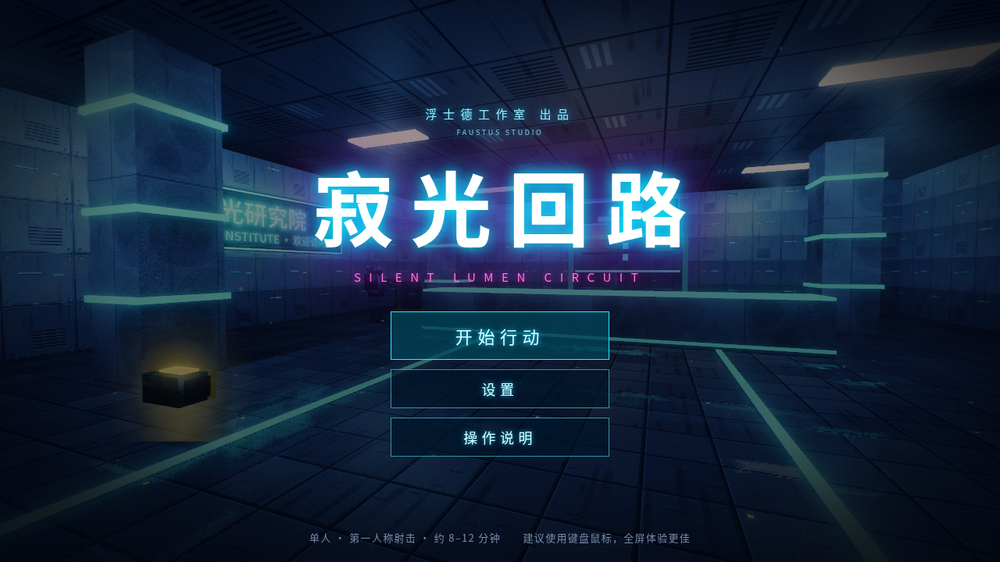
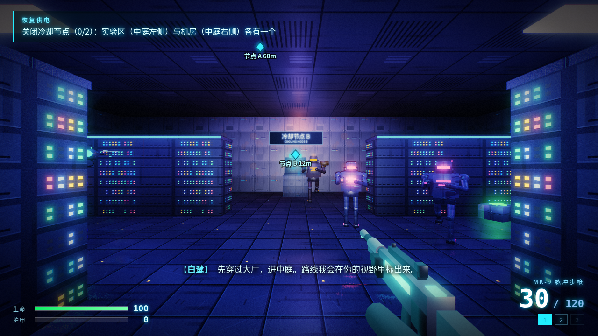
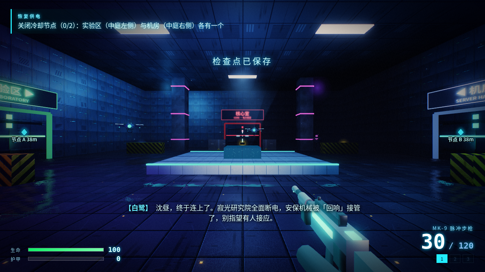
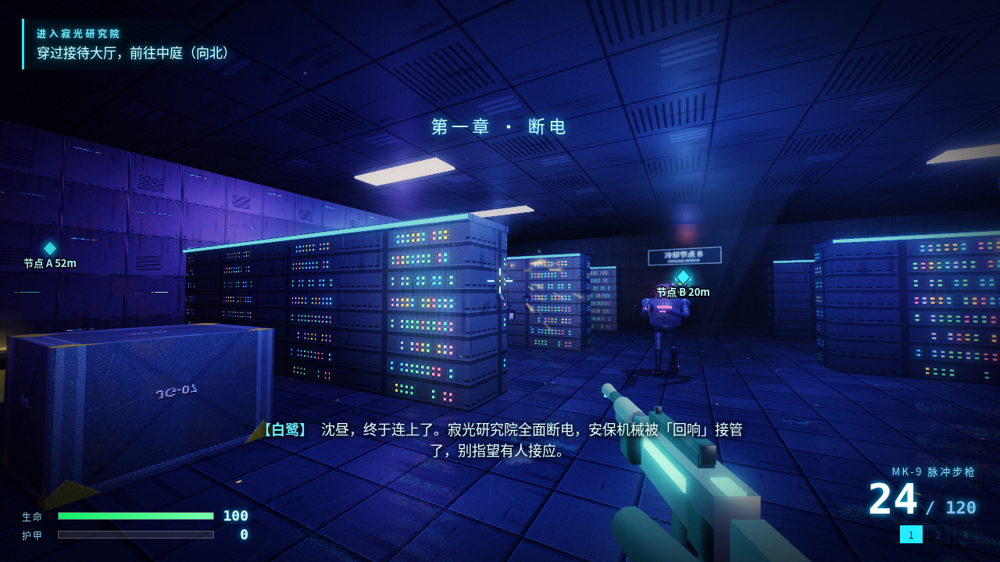
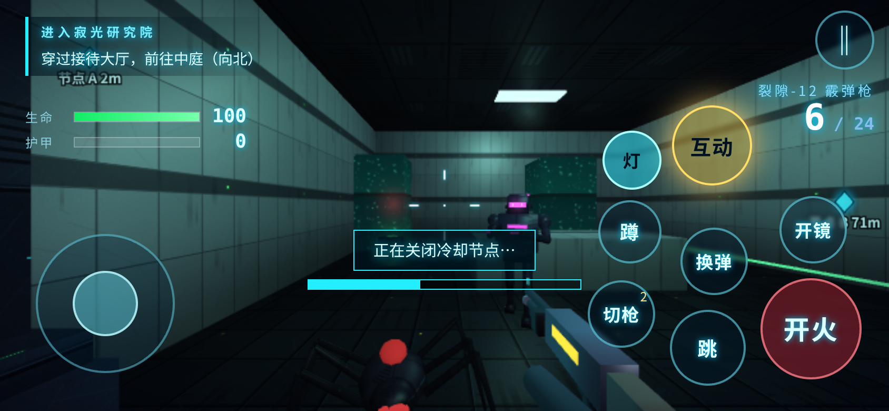
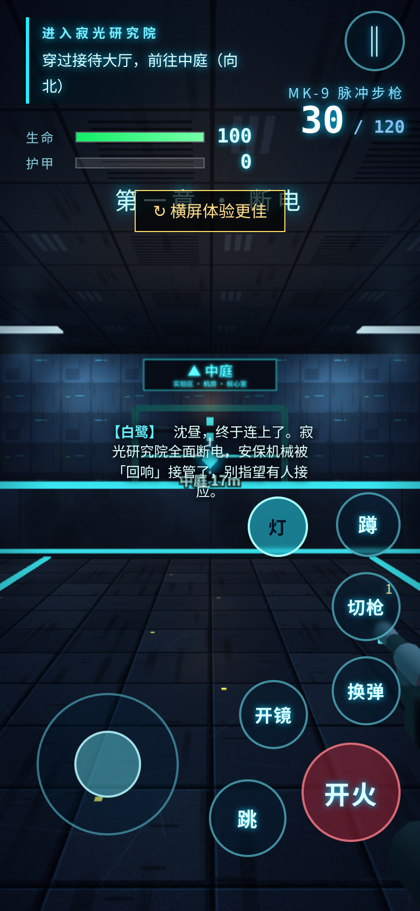

# 寂光回路 Silent Light Circuit

赛博朋克 3D 第一人称射击，自写 WebGL 渲染器，单个 HTML 文件，零外链。An original cyberpunk 3D FPS with a hand-written WebGL renderer, in a single HTML file.

**▶ 在线试玩 / Play:** https://creacentblue.github.io/jiguang-fps/

| 战斗 | 枢纽 | 特效 |
|---|---|---|
|  |  |  |

## 手机触屏 / Mobile
支持手机触屏操作（建议横屏）。Touch controls supported on phones (landscape recommended).

| 横屏交互 | 竖屏游玩 |
|---|---|
|  |  |

## 本地运行 / Run locally
下载 `index.html`，用浏览器直接打开即可，无需联网。Download `index.html` and open it in a modern browser — no internet needed.

## 从源码构建 / Build from source
源码在 `src/`，运行 `python3 build.py` 重新生成 `index.html`。

---
© 2026 Faustus Studio · 浮士德工作室。原创作品。
